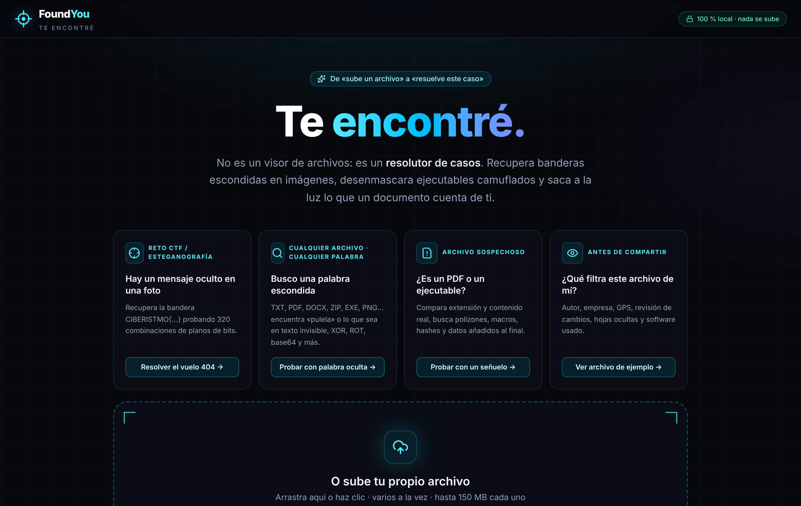
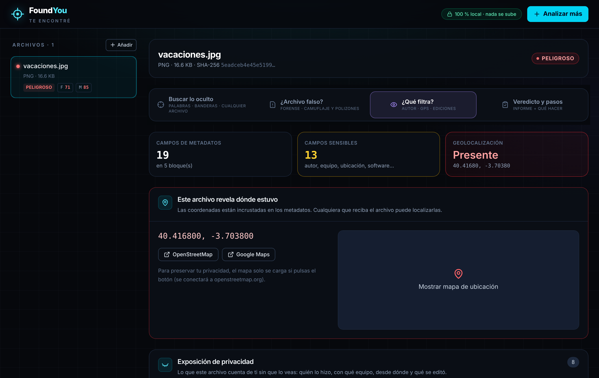
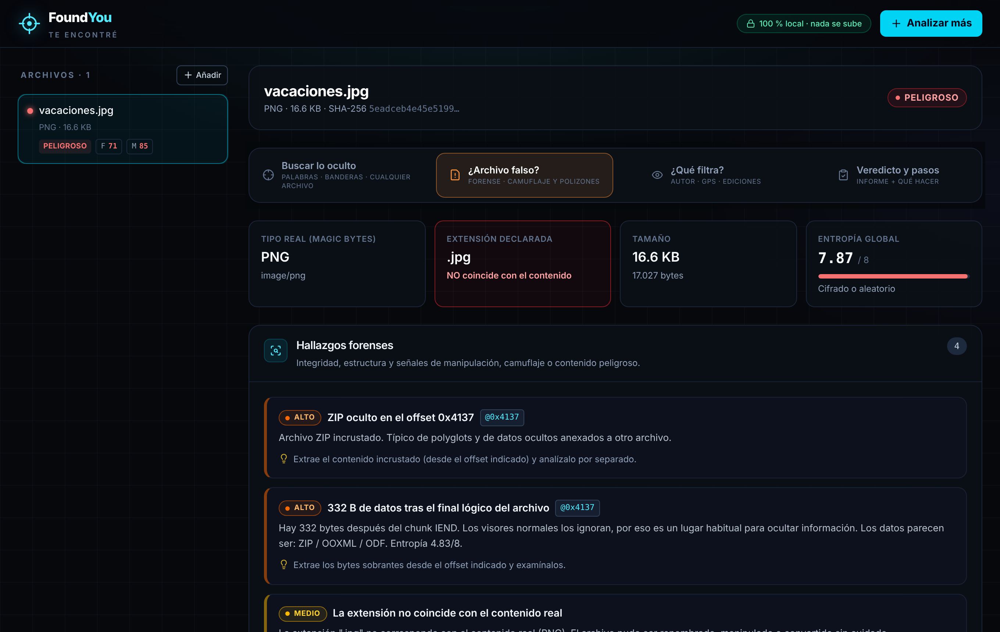
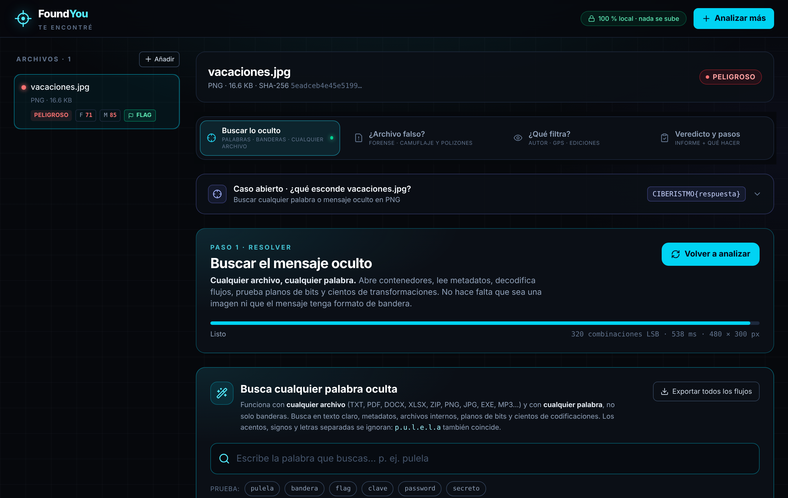
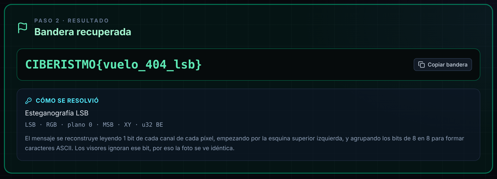
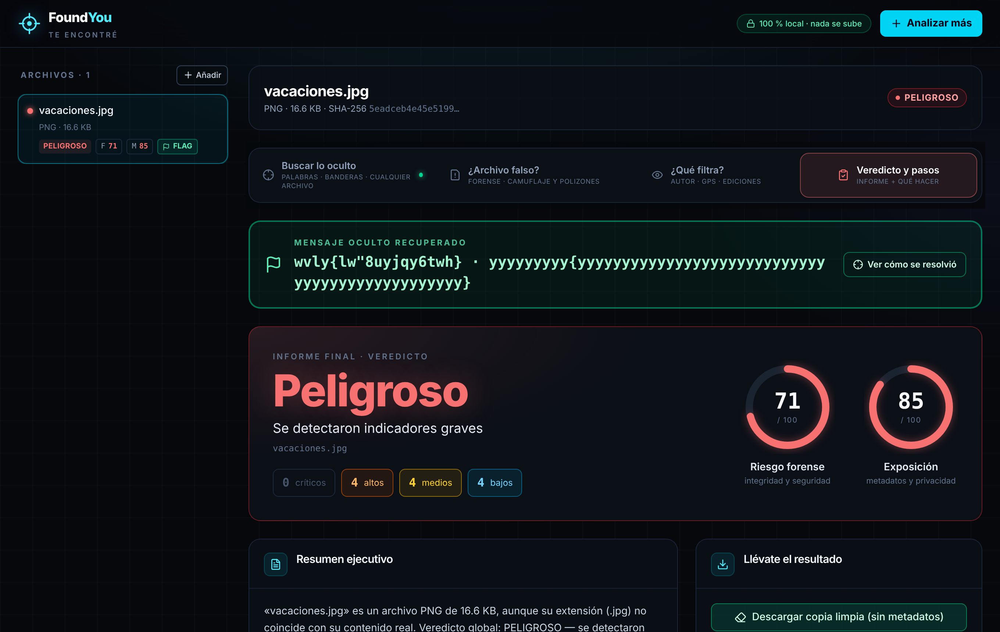

<div align="center">

# FoundYou · *Te encontré*

**No es un visor de archivos: es un resolutor de casos.**
Recupera banderas escondidas en imágenes, desenmascara ejecutables camuflados y descubre lo que un documento cuenta de ti.




</div>

---

## Qué hace

Todo el análisis ocurre **en tu navegador**. Los archivos nunca se suben a ningún servidor. Admite varios archivos a la vez, de hasta 150 MB cada uno.

La pantalla inicial propone cuatro casos de uso:

| Caso | Para qué sirve |
|---|---|
| **Reto CTF / Esteganografía** | Recupera una bandera `CIBERISTMO{...}` oculta en una foto probando 320 combinaciones de planos de bits. |
| **Busco una palabra escondida** | En TXT, PDF, DOCX, ZIP, EXE, PNG… encuentra una palabra en texto invisible, XOR, ROT, base64 y más. |
| **¿Es un PDF o un ejecutable?** | Compara la extensión con el contenido real, busca polizones, macros, hashes y datos añadidos al final. |
| **¿Qué filtra este archivo de mí?** | Muestra autor, empresa, GPS, revisión de cambios, hojas ocultas y software usado. |

---

## Un recorrido por la app

Cada archivo se analiza en cuatro pestañas.

### ¿Qué filtra? — Metadatos y privacidad
Autor, equipo, ubicación, software y ediciones. Si hay coordenadas GPS, las muestra, y el mapa solo se carga si lo pides, para no filtrar tu consulta.



### ¿Archivo falso? — Forense
Firmas de archivo, camuflaje de extensión, polizones, entropía, visor hexadecimal y strings.



### Buscar lo oculto — Palabras y banderas
Rastrea una palabra o bandera en cualquier archivo, con distintas codificaciones, y laboratorio de imagen para esteganografía.



**Ejemplo: recuperando una bandera CIBERISTMO.** Con el reto "El secreto del vuelo 404", la app prueba 320 combinaciones de planos de bits y recupera la bandera oculta en la foto, explicando cómo la encontró.



### Veredicto y pasos — Informe
Un veredicto claro (seguro, sospechoso, peligroso) con puntuaciones y qué hacer a continuación.



---

## Cómo usarla

1. Arrastra uno o varios archivos al recuadro, o haz clic para elegirlos.
2. Selecciona un archivo en la barra lateral.
3. Recorre las cuatro pestañas.
4. ¿Quieres probarla sin archivos? Usa los botones de demo de la pantalla inicial: *Resolver el vuelo 404*, *Probar con palabra oculta*, *Probar con un señuelo* o *Ver archivo de ejemplo*.

## Instalación

Requisitos: Node.js 18 o superior y npm.

```bash
git clone https://github.com/abdiellzz/ifoundyou
cd ifoundyou
npm install
npm run dev
```

Abre `http://localhost:5173`.

Para generar la versión final:

```bash
npm run build     # genera dist/ (un único HTML con vite-plugin-singlefile)
npm run preview
```

## Stack

React 19 · TypeScript · Vite · Tailwind CSS 4 · [exifr](https://github.com/MikeKovarik/exifr) · JSZip · spark-md5 · lucide-react

## Estructura

```
src/
├── components/   Vistas: landing, metadatos, forense, hex, strings, entropía, imagen, informe, CTF
└── lib/          Lógica: firmas, esteganografía, búsqueda de ocultos, limpieza, informes, demos
docs/             Capturas del README
```

## Uso responsable

Úsala solo con archivos propios o con autorización, para análisis forense, aprendizaje y CTFs.
